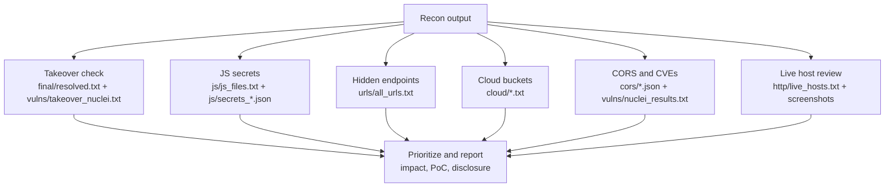

# Bug Bounty Recon Pipeline

A single-file, modular recon automation script for authorized bug bounty and penetration testing engagements. Covers subdomain enumeration, resolution, HTTP probing, crawling, secrets scanning, cloud bucket enumeration, and vulnerability scanning — with graceful fallback when a tool isn't installed.

> ⚠️ **For authorized security testing only.** Only run this against targets you own or have explicit written permission to test (e.g. a program listed on HackerOne / Bugcrowd, inside its stated scope). Running active scans (naabu, ffuf, nuclei) against out-of-scope assets can get you banned from a program or cause legal trouble.

---

## Features

- Parallel passive subdomain enumeration (subfinder, assetfinder, findomain, sublist3r, subdominator)
- Scope filtering against a program's allowed-assets list
- Wildcard DNS detection (avoids false-positive floods)
- DNS resolution + HTTP(S) probing with tech-stack detection
- Optional modules — each skips gracefully if its tool isn't installed:
  - Subdomain takeover check
  - Port scanning (naabu)
  - Crawling + historical URL discovery (katana, gau, waybackurls)
  - Directory brute-forcing (ffuf)
  - JS file collection + secrets scanning (subjs, trufflehog/gitleaks)
  - Cloud storage bucket enumeration
  - GitHub leak scanning
  - CORS misconfiguration scanning
  - WAF/CDN fingerprinting
  - ASN / IP range discovery
  - Favicon-hash fingerprinting
  - Screenshots (gowitness)
- Diff-based monitoring — flags new subdomains since the last run
- Nuclei vulnerability scan with tunable severity and rate limit
- Markdown summary report generated per run
- Batch mode (`-dL`) for multiple domains
- Optional Slack/Discord notification (`notify`) and custom webhook

## Requirements

**Core (required):** `subfinder`, `assetfinder`, `findomain`, `sublist3r`, `subdominator`, `dnsx`, `httpx` (or `httpx-toolkit`), `nuclei`

**Optional (per module):** `naabu`, `katana`, `gau`, `waybackurls`, `ffuf`, `subjs`, `trufflehog` or `gitleaks`, `S3Scanner` or `cloud_enum`, `github-subdomains`, `Corsy`, `wafw00f`, `asnmap`, `favfreak`, `gowitness`, `notify`

You need `go`, `python3`, `pip3` and `git` already installed. Then install every tool with **one command**:

```bash
chmod +x scripts/install.sh

# Core tools only (enough to run recon.sh with no module flags)
./scripts/install.sh

# Everything — core + every optional module tool (needed for --full)
./scripts/install.sh --full
```

The installer skips any tool that's already on your `$PATH`, so it's safe to re-run any time. After it finishes, add Go's bin directory and `~/.local/bin` to your shell profile (the installer prints the exact line to add):

```bash
export PATH="$PATH:$(go env GOPATH)/bin:$HOME/.local/bin"
```

Then verify everything installed correctly:
```bash
which subfinder dnsx httpx nuclei naabu katana gau ffuf subjs trufflehog gowitness
```

## Usage

```bash
chmod +x scripts/recon.sh

# Basic run
./scripts/recon.sh -d example.com

# With scope filtering (recommended)
./scripts/recon.sh -d example.com -s examples/scope.txt

# Full pipeline, all modules
./scripts/recon.sh -d example.com -s examples/scope.txt --full --notify

# Select modules only
./scripts/recon.sh -d example.com --takeover --jsscan --crawl

# Batch mode — multiple domains from a file
./scripts/recon.sh -dL targets.txt --portscan --wafcheck
```

Run `./scripts/recon.sh -h` for the full flag list.

### Scope file format

One pattern per line, matched with `grep -f` against discovered subdomains:
```
.example.com
api.example.com
*.staging.example.com
```

## Output structure

```
<domain>_<timestamp>/
├── raw/        per-tool subdomain enum output
├── final/      merged + scoped + resolved subdomains, diff, wildcard info, SUMMARY.md
├── ports/      naabu port scan results
├── http/       live hosts, tech stack, screenshots
├── urls/       crawled + historical URLs, ffuf results
├── js/         collected JS files + secrets scan results
├── cloud/      cloud bucket enumeration results
├── github/     GitHub leak scan results
├── cors/       CORS misconfig results
├── waf/        WAF/CDN fingerprinting
├── asn/        ASN / IP ranges
├── favicon/    favicon hash fingerprinting
├── vulns/      nuclei + takeover results
└── logs/       full run log
```

## What to check after a run — bug triage workflow

Running the tools only finds *candidates*. Every hit below needs manual verification before it's a real finding — nuclei, CORS scanners, and takeover checks all produce false positives.

**For a full step-by-step breakdown — which tool runs at each phase, what its output looks like, and exactly what to look for to find a real bug — see [`BUG_HUNTING_GUIDE.md`](./BUG_HUNTING_GUIDE.md).**



| Output file | What to look for | Why it matters |
|---|---|---|
| `vulns/takeover_nuclei.txt`, `vulns/takeover_subzy.txt` | CNAME pointing to an unclaimed cloud service (Heroku, S3, GitHub Pages, Azure, etc.) | High-severity, easy-to-prove bug. Register the dangling resource to confirm before reporting. |
| `js/js_files.txt` + `js/secrets_*.json` | Hardcoded API keys, auth tokens, internal URLs, cloud credentials inside JS bundles | Very common finding source — devs leak secrets in client-side code more than you'd expect. |
| `urls/all_urls.txt` | Old API versions, debug/test routes, `admin`, `internal`, `.bak`/`.git`/`.env` paths, parameters that look like IDs or file paths (IDOR/LFI candidates) | Historical crawlers (gau/waybackurls) surface endpoints that are forgotten but still live. |
| `cloud/*.txt` | Publicly listable/readable S3/GCS/Azure buckets named after the company or product | Misconfigured buckets are a classic, high-impact, easy-win category. |
| `cors/cors_results.json` | `Access-Control-Allow-Origin` reflecting arbitrary origins with `Allow-Credentials: true` | Lets an attacker-controlled page read authenticated responses — verify with a real cross-origin PoC. |
| `vulns/nuclei_results.txt` / `.json` | Any `critical`/`high` hit — exposed `.git`, default credentials, known CVEs, exposed panels | Nuclei has false positives — manually reproduce the request before trusting a finding. |
| `http/live_hosts.txt`, `http/screenshots/` | Admin/login panels, staging environments, outdated CMS/framework versions (from `-tech-detect`) | Screenshots make it fast to spot interesting hosts in a list of hundreds. |
| `final/new_subs.txt` | Subdomains that appeared since your last run | New infrastructure often ships without the same hardening as the main site — worth a fresh look. |
| `waf/waf_results.txt` | Whether a WAF/CDN is in front of a host | Informs scanning strategy (rate limits, bypass techniques) — not a bug by itself. |

**General rule:** every automated hit is a lead, not a report. Reproduce it manually, determine real impact (what can an attacker actually do?), and write a clear PoC before submitting.

## Disclaimer

This tool is provided for educational purposes and authorized security testing only. The authors are not responsible for misuse. Always comply with the scope and rules of engagement of any program you test against, and with applicable law.
